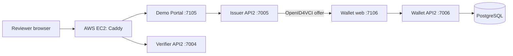

# Fictional Seafarer Credential Demo - AWS Deployment

**Purpose and status.** This proof of concept uses the walt.id stack on AWS EC2 to create a real OpenID4VCI offer, issue a synthetic Open Badge, and hold it in the AWS-hosted wallet. The demo subject and achievement are fictional; no real personal information is used. The badge does not claim that training occurred or that its holder is competent. It is not an official STCW certificate or maritime licence.

**Public review URLs:** [Demo portal](http://3.27.212.96:7105/) | [Wallet](http://3.27.212.96:7106/)

**Cloud access.** The services run on an internet-reachable AWS EC2 instance in Asia Pacific (Sydney). Reviewers can open the portal and wallet directly at the URLs above; the EC2 instance must stay running during review. The accompanying README contains demo wallet login details.

## High-level architecture

The portal is the review entry point. The issuer creates the offer; the wallet redeems it and stores the credential. The verifier API is running, but a presentation and verification flow has not been demonstrated.

## AI integration points

AI could help an authorized training provider map course records to credential fields, flag inconsistent or expired records for human review, and explain credential claims in a seafarer's preferred language. AI should assist staff; it should not decide whether a person is qualified or fit for duty.

## Design decision

I used walt.id's existing Open Badge profile rather than inventing a custom STCW schema. This made it possible to demonstrate a real offer, issuance, and wallet receipt with synthetic data. The achievement references the subject of STCW Basic Training (A-VI/1), but the badge is only a prototype representation and is not an STCW certificate or evidence of course completion.

## Honest limitation

The demo uses fictional claims and an Open Badge profile, not a maritime authority-issued credential or purpose-built STCW schema. It runs on one EC2 host over plain HTTP, without TLS or a custom domain, so traffic is not encrypted and the instance is a single point of failure. Public IP addresses and service ports are exposed for review; this setup is not production-hardened and should contain no real personal or sensitive data. Public IPv4 addresses can change if the instance is stopped and restarted, so the URLs may then need updating. Selective disclosure and verifier presentation have not been demonstrated. The portal's clipboard function may require a secure browser context; an SSH local port forward was used to copy an offer link.

**Deployment:** AWS EC2, Asia Pacific (Sydney). **Public portal:** http://3.27.212.96:7105/. Keep the instance running until the review is complete.

**Reference:** [IMO FAL.2/Circ.133, List of Certificates and Documents Required to Be Carried on Board Ships](https://wwwcdn.imo.org/localresources/en/publications/Documents/IMO-Vega/B-FAL.2-Circ.133%20-%20List%20Of%20Certificates%20And%20Documents%20Required%20To%20Be%20Carried%20On%20Board%20Ships,%202022%20%28Secretariat%29.pdf).
