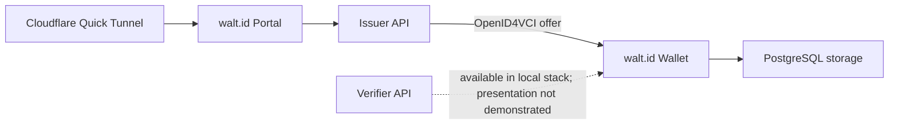

# Fictional Seafarer Credential Demo

A hands-on proof of concept using the open-source [walt.id identity stack](https://github.com/walt-id/waltid-identity). It issues a fictional seafarer safety-training achievement as an Open Badge credential and receives it in the walt.id wallet.

> **Demo only:** This is synthetic data. It does not prove real training or competence and is not an official STCW certificate or a credential from a maritime authority. Do not use it for employment, boarding, or service at sea.

## What is implemented

- walt.id Community Stack started locally with Docker Compose on an Apple Silicon Mac.
- A fictional seafarer safety-training achievement was issued through the walt.id Issuer portal.
- The credential offer was accepted and the credential is held in the walt.id wallet.
- A temporary Cloudflare Quick Tunnel provides a public link to the local portal while the Mac, Docker, and tunnel process remain running.

This is a real issuance and wallet-receipt flow, not a mocked credential. The current deployment runs on a developer laptop. The temporary tunnel does not make the application an always-on cloud deployment. Selective disclosure and verifier presentation have not been demonstrated.

## High-level architecture



The services run in Docker Compose. Caddy routes the local service endpoints. The tunnel currently exposes the portal endpoint; the laptop and containers must stay on for the link to work.

## Run the upstream stack locally

Prerequisites: Docker Desktop and Git.

```bash
git clone https://github.com/walt-id/waltid-identity.git
cd waltid-identity/docker-compose
docker compose up
```

The local demo portal is at `http://localhost:7105`. The wallet UI is at `http://localhost:7106`. Keep all credentials and configuration values synthetic. Never commit passwords, private signing keys, tunnel tokens, or real personal information.

## Limitation

This prototype uses the existing OpenBadge profile and a fictional training achievement, not a custom STCW credential schema. The demo issuer is not a recognized maritime authority. A temporary tunnel is suitable for a short review session, not a reliable cloud deployment; it stops when the laptop, Docker stack, or tunnel process stops. Selective disclosure and verifier presentation remain future work.

See [`CONCEPT-NOTE.pdf`](CONCEPT-NOTE.pdf) for the one-page concept note.
