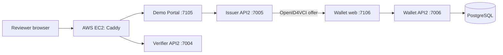

# Fictional Seafarer Credential Demo

A live proof of concept using the open-source [walt.id identity stack](https://github.com/walt-id/waltid-identity), deployed with Docker Compose on an AWS EC2 instance. It demonstrates issuing a synthetic seafarer-training achievement as an Open Badge and receiving it in the walt.id wallet.

> **Demo only:** The subject and achievement data are fictional. The credential does not assert that anyone completed training or is competent. It is not an official STCW certificate, maritime licence, or proof of eligibility to work or sail. No real personal information is used.

## Live demo

| Component | URL |
| --- | --- |
| Demo portal | [http://3.27.212.96:7105/](http://3.27.212.96:7105/) |
| Wallet web app | [http://3.27.212.96:7106/](http://3.27.212.96:7106/) |
| Issuer API | [http://3.27.212.96:7005/](http://3.27.212.96:7005/) |
| Verifier API | [http://3.27.212.96:7004/](http://3.27.212.96:7004/) |

The deployment is intended for review and must remain running while it is being evaluated. The portal's clipboard button may require a secure browser context; the operator used an SSH local port forward to access the portal at `http://localhost:17105` when copying an offer link.

### Demo wallet login

For the reviewer to open the demo wallet:

- Username: `seafarer.demo@example.com`
- Password: `password`

These are demo-only credentials for this homework deployment.

## What is implemented

- The walt.id portal, issuer API, verifier API, wallet web app, wallet API, Caddy reverse proxy, and PostgreSQL run as real Docker services on AWS EC2.
- A real OpenID4VCI offer is created by the issuer and redeemed by the wallet; the resulting synthetic Open Badge is held in the AWS-hosted wallet.
- The demo achievement is conceptually related to STCW Basic Training (A-VI/1), a seafarer training topic referenced in IMO materials. The Open Badge is not an official STCW credential and makes no claim of training completion.
- Selective disclosure and a verifier presentation are not demonstrated.

## Architecture

The public review entry point is the demo portal. The issuer creates the credential offer; the wallet redeems it through OpenID4VCI and stores the issued credential. The verifier service is running but presentation verification is not part of the demonstrated flow.

## Design and limitations

The existing Open Badge profile was chosen to demonstrate a real issuance-and-wallet flow quickly, without creating a custom maritime credential schema or implying authority to certify seafarers. AI could help an authorized issuer map course records to credential fields, flag inconsistent or expired records for human review, and explain claims in a seafarer's preferred language. AI should not decide competence or fitness for duty.

This is a review demo, not a production credential service. It uses fictional data, an Open Badge profile rather than a purpose-built STCW schema, plain HTTP and a single EC2 host. The issuer is not a maritime authority, and the credential has no official or legal standing. Selective disclosure and verifier presentation remain future work.

See [CONCEPT-NOTE.pdf](CONCEPT-NOTE.pdf) for the one-page architecture and design summary.
